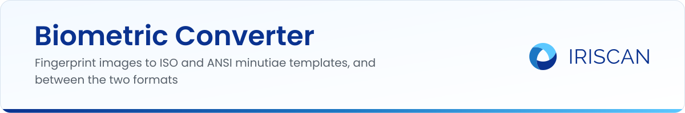
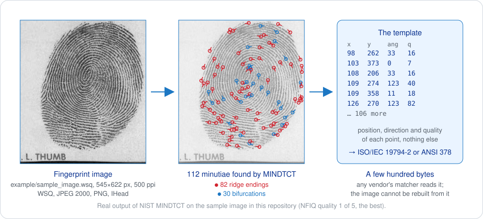
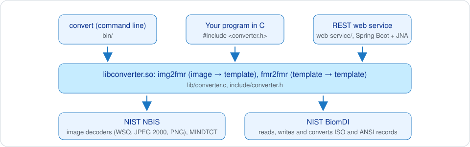

# Biometric Converter

A fingerprint is usually stored not as a picture but as a small list of points, the minutiae, in a standard format that any fingerprint system can read. This project turns a fingerprint image into such a list, and converts the two common standard formats into each other, so that a database built with one vendor's software can be read by another's. It is a C library, a command-line tool and a small web service, built on the public-domain fingerprint software of NIST, the US standards institute.

[](LICENSE.md)
[](https://github.com/biometric-technologies/biometric-converter/stargazers)

> **Status.** The code on `main` has known defects that make its output unusable as it stands (minutiae are detected on the wrong data and written at zero coordinates; template-to-template conversion crashes). The full list with causes is in [docs/REFERENCE.md](docs/REFERENCE.md#known-issues). Iriscan's online converter at [iriscan.com/biometric-data-interchange](https://www.iriscan.com/biometric-data-interchange) runs a separate WebAssembly build of the same NIST engine. Fixes are welcome; the issues table is a good place to start.

## What it does

- Reads fingerprint images in WSQ (the compression format of police and border systems), JPEG, JPEG 2000, PNG and NIST IHead; the format is detected from the file content.
- Finds the minutiae, the ridge endings and bifurcations that identify a finger, with NIST MINDTCT.
- Writes them as an ANSI INCITS 378 record or an ISO/IEC 19794-2 record (full, normal-card or compact-card format), the two standard "fingerprint template" formats.
- Converts existing records between ANSI and ISO.
- Comes as `libconverter.so` for your own programs, `convert` for the shell, and a REST service that takes base64 and returns base64.



## Quick start

With Docker, nothing to install:

```sh
docker build -t biometric-converter-cli .
mkdir -p work && cp example/sample_image.wsq work/
docker run --rm -v "$PWD/work":/opt/work biometric-converter-cli \
    convert -i sample_image.wsq -ti WSQ -o sample.ansi -to ANSI
```

The image builds NBIS, BiomDI and the converter from source on Ubuntu 18.04, so the first build takes a while. To build on your own Linux machine, install NBIS and BiomDI first (commands in [docs/REFERENCE.md](docs/REFERENCE.md#building)), then:

```sh
mkdir build && cd build
cmake .. && make && sudo make install && sudo ldconfig
convert -i ../example/sample_image.wsq -ti WSQ -o sample.ansi -to ANSI
```

Format names for `-ti` and `-to`: `ANSI`, `ISO`, `ISONC` (normal card), `ISOCC` (compact card); any other input type, such as `WSQ` or `PNG`, means "an image, detect the format".

The web service (`web-service/`, Spring Boot) exposes `POST /convert` and `POST /convert-batch` with JSON bodies `{ "input": "<base64>", "inputType": "WSQ", "outputType": "ISO" }`.

## How it works

A fingerprint sensor produces a grey-scale image. Storing and comparing images is slow, big and vendor-specific, so the industry agreed on templates: the coordinates, direction and type of each minutia, written in a fixed binary layout. ANSI INCITS 378 is the American standard, ISO/IEC 19794-2 the international one; they carry the same information in slightly different headers, and the card formats are stripped-down versions that fit on a smart card.

The converter chains three pieces of NIST software: the NBIS image decoders turn the file into pixels, MINDTCT finds the minutiae and their quality, and the BiomDI libraries write and translate the records. `lib/converter.c` is the glue, with two functions, `img2fmr` (image to record) and `fmr2fmr` (record to record). The command-line tool and the web service are thin wrappers around them.



Everything else you may need, including the C API, the web service fields, build steps for NBIS and BiomDI, the Docker images, the limitations and the issue list, is in [docs/REFERENCE.md](docs/REFERENCE.md).

## Where it is used

The engine behind Iriscan's [Biometric Data Interchange](https://www.iriscan.com/biometric-data-interchange) service, which migrates fingerprint databases between vendors and formats.

## Related repositories

- [nist-biometric-image-software-nbis](https://github.com/biometric-technologies/nist-biometric-image-software-nbis): the NBIS mirror this project builds against.
- [nist-biometric-interchange-software-biomdi](https://github.com/biometric-technologies/nist-biometric-interchange-software-biomdi): NIST BiomDI application package; the core BiomDI libraries come from [usnistgov/biomdi](https://github.com/usnistgov/biomdi).
- [biometric-sdk](https://github.com/biometric-technologies/biometric-sdk): iris and face recognition for Android, iOS and the JVM, with ISO/IEC 19794 record serializers.

## License

GNU General Public License v3.0, see [LICENSE.md](LICENSE.md). NBIS and BiomDI are works of the US government and public domain in the United States; the bundled OpenJPEG, libjpeg, libpng and zlib keep their own licenses (listed in the reference). For a closed-source product, Iriscan offers a [commercial license](https://www.iriscan.com/commercial-license).

## Contact

Bugs and ideas: [open an issue](https://github.com/biometric-technologies/biometric-converter/issues). Everything else: info@iriscan.net, https://www.iriscan.com.
