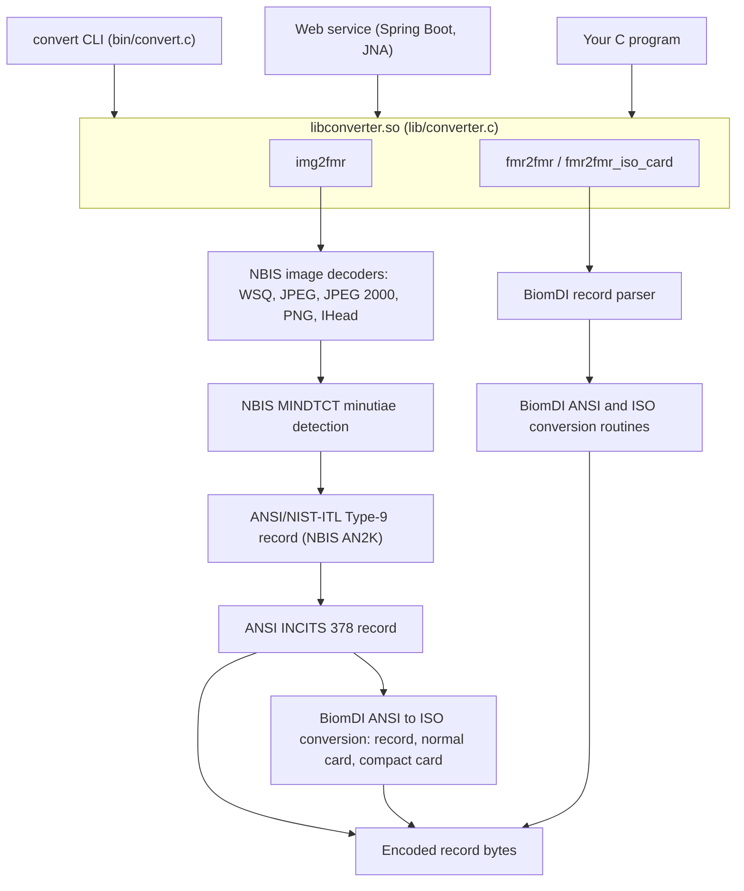

# Biometric Converter: reference

Biometric Converter extracts finger minutiae from fingerprint images and writes
them as finger minutiae records in the
[ANSI INCITS 378](https://tsapps.nist.gov/publication/get_pdf.cfm?pub_id=150619)
and ISO/IEC 19794-2 formats, and converts minutiae records between those
formats. It is built on NIST Biometric Image Software (NBIS) and the NIST BiomDI
libraries and consists of a C library, a command-line tool and a REST web
service.

The project is not a formally recognized reference implementation of either
standard and has not been through conformance testing. Validate its output with
the tools of the system that will consume it.

Developed by Iriscan (Biometric Technologies OÜ) — <https://www.iriscan.com>. The short introduction is in the [README](../README.md).

Online demo: [Biometric Data Interchange](https://www.iriscan.com/biometric-data-interchange)
converts fingerprint images and minutiae templates in the browser, using a
WebAssembly build of the same NBIS and BiomDI based engine. That WebAssembly
build is not part of this repository.

> **Status.** The code in this repository has defects that make its output
> unusable as it stands: minutiae are detected on the wrong data, all minutia
> coordinates are written as zero, and minutiae-to-minutiae conversion crashes.
> See [Known issues](#known-issues) before relying on it.

## Contents

- [Features](#features)
- [Formats and conversions](#formats-and-conversions)
- [Architecture](#architecture)
- [Repository layout](#repository-layout)
- [Building](#building)
- [Usage](#usage)
- [Known issues](#known-issues)
- [Limitations](#limitations)
- [License](#license)
- [Contributing](#contributing)

## Features

- Decoding of fingerprint images with the NBIS decoders: WSQ, JPEG (baseline
  and lossless), JPEG 2000, PNG and NIST IHead. The image format is detected
  from the file content.
- Minutiae detection with NBIS MINDTCT.
- Output as an ANSI INCITS 378 record, or as an ISO/IEC 19794-2 record in the
  full record format, the normal card format or the compact card format.
- Conversion of minutiae records between the ANSI and ISO formats, using the
  BiomDI conversion routines.
- Three interfaces: a shared library (`libconverter.so`), a command-line tool
  (`convert`) and a Spring Boot web service that calls the library through JNA.
- Dockerfiles for the command-line tool and for a base image of the web
  service.

## Formats and conversions

### Format identifiers

| Identifier | Format | Input | Output |
|---|---|---|---|
| (detected) | WSQ, JPEG baseline, JPEG lossless, JPEG 2000, PNG, NIST IHead images, 8-bit grey scale | yes | no |
| `ANSI` | ANSI INCITS 378-2004 finger minutiae record | yes | yes |
| `ISO` | ISO/IEC 19794-2:2005 finger minutiae record, record format | yes | yes |
| `ISONC` | ISO/IEC 19794-2:2005, normal card format | yes | yes |
| `ISOCC` | ISO/IEC 19794-2:2005, compact card format | yes | yes |

These are the strings the library accepts. BiomDI also supports
ANSI INCITS 378-2009, which this project does not expose. The web service uses
its own names; see [Web service](#web-service).

### Conversion directions

| From | To | Library function | Result at the time of writing |
|---|---|---|---|
| image | `ANSI` | `img2fmr` | record produced; minutiae wrong (issues 1, 2) |
| image | `ISO` | `img2fmr` | fails with `could not push FMR` (issue 3) |
| image | `ISONC`, `ISOCC` | `img2fmr` | record produced; minutiae wrong (issues 1, 2) |
| `ANSI` | `ISO`, `ISONC`, `ISOCC` | `fmr2fmr` | crashes (issue 4) |
| `ISO`, `ISONC`, `ISOCC` | `ANSI` | `fmr2fmr`, `fmr2fmr_iso_card` | crashes (issue 4) |
| any minutiae format | the same format | `fmr2fmr` | crashes (issue 4) |

Conversions between the ISO variants (for example `ISO` to `ISOCC`) are not
implemented: the code routes them through the ISO-to-ANSI path.

## Architecture



Image to minutiae (`img2fmr`):

1. The NBIS decoders identify the image format and decode the pixels; the
   resolution is taken from the image, or 500 ppi is assumed when the image has
   none.
2. MINDTCT (`get_minutiae` with the NBIS V2 parameters) detects minutiae,
   their direction, type and reliability.
3. The results are stored in an ANSI/NIST-ITL Type-9 record and converted to an
   ANSI INCITS 378 record, including ridge counts as extended data. This step is
   adapted from the BiomDI `an2k2fmr` tool.
4. For ISO output the record is converted with the BiomDI `ansi2iso_fvmr` or
   `ansi2isocc_fvmr` routines.
5. The record is serialized with the BiomDI writer and returned as a byte
   buffer.

Minutiae to minutiae (`fmr2fmr`) parses the input record with BiomDI and
applies the BiomDI conversion routines (adapted from the BiomDI `fmr2fmr`
tool). ISO card formats do not carry the image resolution, so
`fmr2fmr_iso_card` takes it as arguments.

## Repository layout

| Path | Content |
|---|---|
| `include/converter.h` | Public C API |
| `lib/converter.c` | Library: image decoding, minutiae extraction, record conversion |
| `bin/convert.c` | Command-line tool |
| `example/` | Minimal C program that converts `sample_image.wsq` to ANSI |
| `web-service/` | REST web service (Kotlin, Spring Boot 2.7, WebFlux, JNA) |
| `CMakeLists.txt` | Builds `libconverter.so` and `convert` |
| `Dockerfile` | Image with the command-line tool |
| `DockerfileWs` | Base image with the native libraries and Java 11 for the web service |

NBIS and BiomDI are not included; they are cloned and built separately (the
`.gitmodules` entry for NBIS has no corresponding submodule in the tree).

## Building

The steps below were checked on Ubuntu 24.04 with GCC 13.3 and CMake 3.28.
The Dockerfiles use Ubuntu 18.04.

### Prerequisites

- Git, Make, CMake 3.10.2 or later, GCC
- JDK 11, for the web service
- Docker, optional

### 1. NBIS

Use the Biometric Technologies fork of NBIS:

```sh
git clone https://github.com/biometric-technologies/nist-biometric-image-software-nbis.git
cd nist-biometric-image-software-nbis
./setup.sh /usr/local --without-X11 --64
make config
make it
sudo make install LIBNBIS=no
```

NBIS defines global variables in header files. GCC 10 and later reject this by
default (`multiple definition` errors when linking `an2k/bin/histogen`). With
those compilers, add `-fcommon` to the `CFLAGS` line of `rules.mak` after
running `setup.sh`, and run `make clean` before `make it` if a build already
failed. GCC 9 and earlier need no change.

### 2. BiomDI

```sh
git clone https://github.com/usnistgov/biomdi.git
cd biomdi
make
sudo make install
```

BiomDI installs to `/usr/local` and finds the NBIS headers there. For another
location, change `PREFIX` in `common/common.mk`.

### 3. Library and command-line tool

`CMakeLists.txt` sets the dependency and installation paths with `set()`, so
edit the file to change them (`-D` options on the command line do not override
them):

| Variable | Default | |
|---|---|---|
| `DEP_INCLUDE_DIR` | `/usr/local/include` | NBIS and BiomDI headers |
| `DEP_LINK_DIR` | `/usr/local/lib` | NBIS and BiomDI libraries |
| `INSTALL_INCLUDE_DIR` | `/usr/local/include` | where `converter.h` is installed |
| `INSTALL_LINK_DIR` | `/usr/local/lib` | where `libconverter.so` is installed |
| `INSTALL_BIN_DIR` | `/usr/local/bin` | where `convert` is installed |

```sh
mkdir build
cd build
cmake ..
make
sudo make install
sudo ldconfig
```

`libconverter.so` links the NBIS libraries statically and the BiomDI
`libfmr.so` dynamically, so `libfmr.so` must be on the library path at run
time.

### 4. Web service

```sh
cd web-service
./gradlew clean build
java -jar build/libs/web-service-0.0.2-SNAPSHOT.jar
```

The wrapper uses Gradle 7.4.1; the project targets Java 11. At run time the
service loads `libconverter` through JNA from `/usr/local/lib` or the system
library path and listens on port 8080.

### Docker

Command-line tool:

```sh
docker build -t biometric-converter-cli .
mkdir -p work && cp example/sample_image.wsq work/
docker run --rm -v "$PWD/work":/opt/work biometric-converter-cli \
  convert -i sample_image.wsq -ti WSQ -o sample.ansi -to ANSI
```

The image clones and builds NBIS and BiomDI from GitHub, then the converter, on
Ubuntu 18.04. The working directory in the container is `/opt/work`.

Web service: `DockerfileWs` builds an image with the native libraries and the
Java 11 runtime but no application. The Jib configuration in
`web-service/build.gradle.kts` builds the service image on top of
`biometrictechnologies/ubuntu-clib-java11` and tags it
`biometrictechnologies/biometric-converter`:

```sh
cd web-service
./gradlew jib
```

Prebuilt images have been published on Docker Hub as
`biometrictechnologies/biometric-converter-cli` and
`biometrictechnologies/biometric-converter`.

### WebAssembly

This repository contains no WebAssembly build. The browser demo linked above
uses a separate WebAssembly build that is not published here.

## Usage

### Command-line tool

```text
convert -i <input file> -ti <input type> -o <output file> -to <output type>
```

| Option | Description |
|---|---|
| `-i` | Input file |
| `-ti` | Input type. `ANSI`, `ISO`, `ISONC` or `ISOCC` for a minutiae record; any other value (for example `WSQ`) treats the input as an image, whose format is detected from the content |
| `-o` | Output file |
| `-to` | Output type: `ANSI`, `ISO`, `ISONC` or `ISOCC` |
| `-v` | Accepted, but has no effect |

```sh
convert -i finger.wsq -ti WSQ -o finger.ansi -to ANSI
convert -i finger.png -ti PNG -o finger.isocc -to ISOCC
convert -i finger.ansi -ti ANSI -o finger.iso -to ISO
```

The tool prints the selected types and a success line to standard output, and
NBIS diagnostic messages to standard error. An unknown output type produces an
ANSI record. The built-in help lists `ISOC`; the code expects `ISONC`.

### C library

```c
#include <converter.h>

int img2fmr(unsigned char *idata, int ilen, char *otype,
            unsigned char **odata, int *olen);

int fmr2fmr(unsigned char *idata, int ilen, unsigned char **odata, int *olen,
            char *in_type_str, char *out_type_str);

int fmr2fmr_iso_card(unsigned char *idata, int ilen, unsigned char **odata, int *olen,
                     char *in_type_str, char *out_type_str, int iso_c_xres, int iso_c_yres);
```

| Function | Purpose |
|---|---|
| `img2fmr` | Image bytes (`idata`, `ilen`) to a minutiae record of type `otype` |
| `fmr2fmr` | Minutiae record of type `in_type_str` to type `out_type_str` |
| `fmr2fmr_iso_card` | As `fmr2fmr`, with the image resolution for ISO card inputs, which do not carry it. `iso_c_xres` and `iso_c_yres` are in pixels per centimetre, as in the record header (197 for 500 ppi) |

Type strings are the identifiers from [Format identifiers](#format-identifiers).
The output buffer is allocated with `malloc` and belongs to the caller. The
functions return 0; on an error they print a message to standard error and
call `exit()`, which ends the calling process.

Example (adapted from `example/example.c`):

```c
#include <stdio.h>
#include <stdlib.h>
#include <converter.h>

int main(void) {
    FILE *f = fopen("sample_image.wsq", "rb");
    fseek(f, 0, SEEK_END);
    int ilen = ftell(f);
    fseek(f, 0, SEEK_SET);
    unsigned char *idata = malloc(ilen);
    fread(idata, 1, ilen, f);
    fclose(f);

    unsigned char *odata;
    int olen;
    img2fmr(idata, ilen, "ANSI", &odata, &olen);

    FILE *out = fopen("sample.ansi", "wb");
    fwrite(odata, 1, olen, out);
    fclose(out);
    free(odata);
    free(idata);
    return 0;
}
```

```sh
gcc example.c -o example -lconverter
```

If the libraries are not in a standard location, add `-I<include dir>`,
`-L<lib dir>` and `-Wl,-rpath-link,<lib dir>` (so the linker finds
`libfmr.so`), and set `LD_LIBRARY_PATH` when running.

### Web service

Requests and responses are JSON; binary data is base64. Cross-origin requests
are allowed from any origin, and request bodies up to 128 MB are accepted.

Format names in the web service:

| Name | Meaning |
|---|---|
| `WSQ`, `JPEG`, `IHEAD`, `JPEG2000`, `PNG` | Image input. The name only selects image conversion; the format is detected from the content |
| `ANSI`, `ISO`, `ISOCC` | Minutiae formats as in the library |
| `ISOC` | ISO normal card format (the library calls it `ISONC`; see issue 6) |

#### POST /convert

| Field | Type | Description |
|---|---|---|
| `input` | string | Input file, base64 |
| `inputType` | string | Format name of the input |
| `outputType` | string | Format name of the output (a minutiae format) |
| `imageResX` | integer | Optional. X resolution for ISO card conversions, pixels per centimetre |
| `imageResY` | integer | Optional. Y resolution for ISO card conversions, pixels per centimetre |

```sh
curl -s http://localhost:8080/convert \
  -H 'Content-Type: application/json' \
  -d "{\"input\": \"$(base64 -w0 finger.wsq)\", \"inputType\": \"WSQ\", \"outputType\": \"ANSI\"}"
```

```json
{"output": "Rk1SACAyMAAKOQABAAEAAAIh..."}
```

`output` is the converted record, base64. A combination that is not supported
(for example a minutiae input with an image output) returns HTTP 500.

#### POST /convert-batch

```json
{
  "data": [
    {"id": "left-index", "input": "...", "inputType": "WSQ", "outputType": "ANSI"},
    {"id": "right-index", "input": "...", "inputType": "ANSI", "outputType": "ISO"}
  ]
}
```

Each item has the fields of `/convert` plus `id`. The response lists one
`{id, output}` per item:

```json
{
  "data": [
    {"id": "left-index", "output": "..."},
    {"id": "right-index", "output": "..."}
  ]
}
```

Items are converted concurrently. The current implementation returns them in
request order; match results by `id`.

## Known issues

Confirmed by building the code and converting `example/sample_image.wsq` and
other test images, except where marked as found by code reading.

| # | Issue | Effect |
|---|---|---|
| 1 | `img2fmr` passes the encoded input bytes, not the decoded pixels, to minutiae detection (`read_minutiae_to_ansi_fmr(idata, ...)` instead of `imdata`) | Minutiae are detected in noise. The sample gives 125 minutiae instead of the 112 that NBIS `mindtct` finds; other inputs hit the limit of 255 |
| 2 | Minutia coordinates are converted before the record resolution is set, so the resolution used is 0 | Every minutia is written at (0, 0), even with issue 1 fixed |
| 3 | Image to `ISO` (full record format) | Fails with `could not push FMR` and exit status 1; `ISONC` and `ISOCC` are written |
| 4 | `fmr2fmr` and `fmr2fmr_iso_card` pass uninitialized record pointers to the BiomDI parser | Every minutiae-to-minutiae conversion ends with a segmentation fault, from the CLI and from a direct library call |
| 5 | The CLI passes the input file path instead of the input type to `fmr2fmr` (code reading) | Would select no valid conversion once issue 4 is fixed |
| 6 | The web service passes `inputType` instead of `outputType` to `img2fmr`, and sends `ISOC`, which the library does not recognize (found by code reading) | Image conversions in the web service always return ANSI; `ISOC` conversions do not work |
| 7 | The library calls `exit()` on errors and keeps static state (a per-finger view counter) (code reading) | An error terminates the host process, including the web service JVM; concurrent calls, as in `/convert-batch`, are not safe |
| 8 | Allocated records and buffers are not released (code reading) | Memory grows in long-running processes such as the web service |
| 9 | For PNG input the image resolution is written as 65535 | Resolution field is wrong; detection itself assumes 500 ppi |
| 10 | `example/CMakeLists.txt` calls `find_library` without a library name and uses `/usr/local/lib/include` | CMake 3.28 stops with an error; build the example with the `gcc` command above |

## Limitations

- **Image input.** 8-bit grey-scale images in the formats NBIS decodes. BMP and
  TIFF are not supported. Images without resolution information are processed
  at 500 ppi.
- **Record content.** Finger position and impression type are written as 0
  (unknown), finger quality as 0, and minutia quality is the MINDTCT
  reliability value. The CBEFF product identifier is a placeholder
  (`0x00010001`).
- **Extended data.** Ridge counts are written for image input. Core, delta and
  ridge-count blocks are dropped in minutiae-to-minutiae conversions.
- **Formats.** One finger view per image. ANSI INCITS 378-2009, ISO/IEC
  19794-2:2011 and ANSI/NIST-ITL transactions are not produced.
- **Third-party code.** NBIS bundles old versions of libpng (1.2.23) and zlib
  (1.2.3) that have published vulnerabilities. Do not process untrusted files
  with elevated privileges.
- **Accuracy.** No accuracy or interoperability measurements are published for
  this code.

## License

Biometric Converter is released under the GNU General Public License v3.0; see
[LICENSE.md](LICENSE.md).

Third-party code used by the build:

| Component | Use | License |
|---|---|---|
| [NBIS](https://github.com/biometric-technologies/nist-biometric-image-software-nbis) (NIST) | Image decoding, MINDTCT, ANSI/NIST-ITL records; linked statically into `libconverter.so` and `convert` | Public domain in the United States (works of NIST employees, 15 U.S.C. 105), provided as is |
| [BiomDI](https://github.com/usnistgov/biomdi) (NIST) | Minutiae record parsing, writing and conversion; `libfmr.so` linked dynamically | Public domain in the United States, provided as is |
| OpenJPEG, bundled with NBIS | JPEG 2000 decoding | BSD 2-clause |
| IJG libjpeg, bundled with NBIS | JPEG baseline decoding | IJG license |
| libpng, bundled with NBIS | PNG decoding | libpng license |
| zlib, bundled with NBIS | PNG decompression | zlib license |
| Spring Boot, Jackson, Kotlin, kotlinx.coroutines, Apache Commons Codec | Web service | Apache License 2.0 |
| JNA | Web service, native calls | Apache License 2.0 or LGPL 2.1 |

`lib/converter.c` contains code adapted from the BiomDI tools `an2k2fmr`,
`fmr2fmr` and `fmr2an2k` and from the NBIS image reading routines. NBIS also
contains JasPer, which this build does not link. Binary distributions, such as
the Docker images, include the third-party libraries above; keep their notices
when redistributing.

## Contributing

Bug reports with steps to reproduce, and feature requests, go to
[GitHub issues](https://github.com/biometric-technologies/biometric-converter/issues).
Pull requests are welcome; please:

- describe the input files and commands used to test the change, and attach
  small sample files where possible;
- check records with the BiomDI tools (`prfmr -v -ti <type> <file>` prints and
  validates a record) and, for image input, compare minutiae with NBIS
  `mindtct`;
- keep changes to the vendored NIST code paths minimal and say where code was
  adapted from.

Other questions can be sent to the
[Biometric Technologies project maintainers](mailto:info@iriscan.net).

---

Developed by Iriscan (Biometric Technologies OÜ) — <https://www.iriscan.com>. The short introduction is in the [README](../README.md).
<https://www.iriscan.com>
