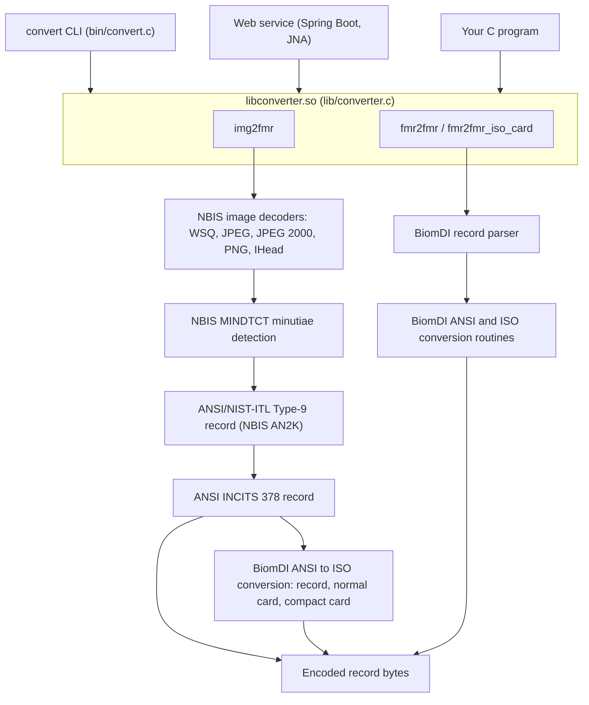

# Biometric Converter: reference

Biometric Converter extracts finger minutiae from fingerprint images and writes
them as finger minutiae records in the
[ANSI INCITS 378](https://tsapps.nist.gov/publication/get_pdf.cfm?pub_id=150619)
and ISO/IEC 19794-2 formats, and converts minutiae records between those
formats. It is built on NIST Biometric Image Software (NBIS) and the NIST BiomDI
libraries and consists of a C library, a command-line tool and a REST web
service.

The project is not a formally recognized reference implementation of either
standard and has not been through conformance testing. Validate its output with
the tools of the system that will consume it.

Developed by Iriscan (Biometric Technologies OÜ) — <https://www.iriscan.com>. The short introduction is in the [README](../README.md).

Online demo: [Biometric Data Interchange](https://www.iriscan.com/biometric-data-interchange)
converts fingerprint images and minutiae templates in the browser, using a
WebAssembly build of the same NBIS and BiomDI based engine. That WebAssembly
build is not part of this repository.

> **Status.** The defects that made the output of earlier versions unusable
> are fixed: minutiae are detected on the decoded image and written at their
> real positions, image to `ISO` works, and minutiae-to-minutiae conversion
> works in every direction instead of crashing. On `example/sample_image.wsq`
> the ANSI record holds the same 112 minutiae, at the same positions and
> angles, as NBIS `mindtct -m1`. `tests/run.sh` checks this. What is still
> open is listed under [Known issues](#known-issues).

## Contents

- [Features](#features)
- [Formats and conversions](#formats-and-conversions)
- [Architecture](#architecture)
- [Repository layout](#repository-layout)
- [Building](#building)
- [Usage](#usage)
- [Known issues](#known-issues)
- [Limitations](#limitations)
- [License](#license)
- [Contributing](#contributing)

## Features

- Decoding of fingerprint images with the NBIS decoders: WSQ, JPEG (baseline
  and lossless), JPEG 2000, PNG and NIST IHead. The image format is detected
  from the file content.
- Minutiae detection with NBIS MINDTCT.
- Output as an ANSI INCITS 378 record, or as an ISO/IEC 19794-2 record in the
  full record format, the normal card format or the compact card format.
- Conversion of minutiae records between any two of the ANSI and ISO formats,
  using the BiomDI conversion routines.
- Three interfaces: a shared library (`libconverter.so`), a command-line tool
  (`convert`) and a Spring Boot web service that calls the library through JNA.
- Dockerfiles for the command-line tool and for a base image of the web
  service.

## Formats and conversions

### Format identifiers

| Identifier | Format | Input | Output |
|---|---|---|---|
| (detected) | WSQ, JPEG baseline, JPEG lossless, JPEG 2000, PNG, NIST IHead images, 8-bit grey scale | yes | no |
| `ANSI` | ANSI INCITS 378-2004 finger minutiae record | yes | yes |
| `ISO` | ISO/IEC 19794-2:2005 finger minutiae record, record format | yes | yes |
| `ISONC` | ISO/IEC 19794-2:2005, normal card format | yes | yes |
| `ISOCC` | ISO/IEC 19794-2:2005, compact card format | yes | yes |

These are the strings the library accepts. BiomDI also supports
ANSI INCITS 378-2009, which this project does not expose. The web service uses
its own names; see [Web service](#web-service).

### Conversion directions

| From | To | Library function | Result with `example/sample_image.wsq` |
|---|---|---|---|
| image | `ANSI` | `img2fmr` | 112 minutiae, identical in position and angle to `mindtct -m1` |
| image | `ISO`, `ISONC` | `img2fmr` | 112 minutiae, positions within 0.1 pixel of the ANSI record |
| image | `ISOCC` | `img2fmr` | 95 minutiae: the 17 beyond the 25.5 mm reach of the format are left out (see [Limitations](#limitations)); positions within 1 pixel |
| `ANSI` | `ISO`, `ISONC`, `ISOCC` | `fmr2fmr` | works |
| `ISO`, `ISONC`, `ISOCC` | `ANSI` | `fmr2fmr`, `fmr2fmr_iso_card` | works |
| `ISO`, `ISONC`, `ISOCC` | another ISO variant | `fmr2fmr`, `fmr2fmr_iso_card` | works |
| any minutiae format | the same format | `fmr2fmr` | works |

All 16 minutiae-to-minutiae directions were run on the records made from the
sample image, each followed by the conversion back. Minutiae counts are kept
(apart from the compact card range). Compared with the minutiae of the image,
no position moved by more than 1.06 pixels and no angle by more than
2 degrees, one ANSI angle step; the formats store angles in steps of
2 degrees (ANSI), 1.4 degrees (`ISO`, `ISONC`) and 5.6 degrees (`ISOCC`).

Conversions between the ISO variants are done directly: positions through
millimetres, angles between the 256-step and 64-step units. BiomDI has no
routine for them, and going through ANSI would round every angle to
2 degrees.

## Architecture



Image to minutiae (`img2fmr`):

1. The NBIS decoders identify the image format and decode the pixels; the
   resolution is taken from the image (for PNG from its `pHYs` chunk, which
   the NBIS decoder ignores), or 500 ppi is assumed when the image has none.
2. MINDTCT (`get_minutiae` with the NBIS V2 parameters) detects minutiae,
   their direction, type and reliability.
3. The results are stored in an ANSI/NIST-ITL Type-9 record and converted to an
   ANSI INCITS 378 record, including ridge counts as extended data. Positions
   are converted back to the pixels MINDTCT found (origin at the top left),
   the resolution is written in pixels per centimetre (197 for 500 ppi), and
   the minutia quality is the MINDTCT reliability times 100. This step is
   adapted from the BiomDI `an2k2fmr` tool.
4. For ISO output the record is converted with the BiomDI `ansi2iso_fvmr` or
   `ansi2isocc_fvmr` routines.
5. The record is serialized with the BiomDI writer and returned as a byte
   buffer.

Minutiae to minutiae (`fmr2fmr`) parses the input record with BiomDI and
applies the BiomDI conversion routines (adapted from the BiomDI `fmr2fmr`
tool), or the direct conversion between ISO variants described above. ISO
card formats do not carry the image resolution, so `fmr2fmr_iso_card` takes
it as arguments; `fmr2fmr` assumes 500 ppi for them.

## Repository layout

| Path | Content |
|---|---|
| `include/converter.h` | Public C API |
| `lib/converter.c` | Library: image decoding, minutiae extraction, record conversion |
| `bin/convert.c` | Command-line tool |
| `example/` | Minimal C program that converts `sample_image.wsq` to ANSI |
| `tests/` | Test program and script, run by `ctest` |
| `third_party/` | Patch for BiomDI (memory leak), applied before building it |
| `web-service/` | REST web service (Kotlin, Spring Boot 2.7, WebFlux, JNA) |
| `CMakeLists.txt` | Builds `libconverter.so` and `convert` |
| `Dockerfile` | Image with the command-line tool |
| `DockerfileWs` | Base image with the native libraries and Java 11 for the web service |

NBIS and BiomDI are not included; they are cloned and built separately (the
`.gitmodules` entry for NBIS has no corresponding submodule in the tree).

## Building

The steps below were checked on Ubuntu 24.04 with GCC 13.3 and CMake 3.28.
The Dockerfiles use Ubuntu 18.04.

### Prerequisites

- Git, Make, CMake 3.10.2 or later, GCC
- JDK 11, for the web service
- Docker, optional

### 1. NBIS

Use the Biometric Technologies fork of NBIS:

```sh
git clone https://github.com/biometric-technologies/nist-biometric-image-software-nbis.git
cd nist-biometric-image-software-nbis
./setup.sh /usr/local --without-X11 --64
make config
make it
sudo make install LIBNBIS=no
```

NBIS defines global variables in header files. GCC 10 and later reject this by
default (`multiple definition` errors when linking `an2k/bin/histogen`). With
those compilers, add `-fcommon` to the `CFLAGS` line of `rules.mak` after
running `setup.sh`, and run `make clean` before `make it` if a build already
failed. GCC 9 and earlier need no change.

### 2. BiomDI

```sh
git clone https://github.com/usnistgov/biomdi.git
cd biomdi
git checkout acf76a030b0193faafb55fb469b27741b6aa8874
git apply ../biometric-converter/third_party/biomdi-free-unread-records.patch
make
sudo make install
```

The patch frees records that BiomDI allocates and loses when a read stops
in the middle of a record (every ISO card record is read that way). Without
it the converter works, but leaks 48 bytes per card record read.

BiomDI installs to `/usr/local` and finds the NBIS headers there. For another
location, change `PREFIX` in `common/common.mk`.

### 3. Library and command-line tool

`CMakeLists.txt` sets the dependency and installation paths with `set()`, so
edit the file to change them (`-D` options on the command line do not override
them):

| Variable | Default | |
|---|---|---|
| `DEP_INCLUDE_DIR` | `/usr/local/include` | NBIS and BiomDI headers |
| `DEP_LINK_DIR` | `/usr/local/lib` | NBIS and BiomDI libraries |
| `INSTALL_INCLUDE_DIR` | `/usr/local/include` | where `converter.h` is installed |
| `INSTALL_LINK_DIR` | `/usr/local/lib` | where `libconverter.so` is installed |
| `INSTALL_BIN_DIR` | `/usr/local/bin` | where `convert` is installed |

```sh
mkdir build
cd build
cmake ..
make
ctest --output-on-failure
sudo make install
sudo ldconfig
```

`libconverter.so` links the NBIS libraries statically and the BiomDI
`libfmr.so` dynamically, so `libfmr.so` must be on the library path at run
time.

`ctest` runs `tests/run.sh`, which uses `example/sample_image.wsq`. It runs
the test program `test_converter` (every conversion direction, error
reporting, eight threads converting at once) and the command-line tool. When
the NBIS tools `mindtct` and `dwsq` and `python3` are on the path, it also
compares the minutiae with `mindtct -m1` and checks PNG input with and without
a resolution. `VALGRIND=1 tests/run.sh build` adds a few conversions under
valgrind, which must report no leaks (BiomDI built with the patch in
`third_party/`).

### 4. Web service

```sh
cd web-service
./gradlew clean build
java -jar build/libs/web-service-0.0.2-SNAPSHOT.jar
```

The wrapper uses Gradle 7.4.1, which runs on JDK 11 to 17 (not on newer
JDKs); the project targets Java 11. At run time the
service loads `libconverter` through JNA from `/usr/local/lib` or the system
library path and listens on port 8080.

### Docker

Command-line tool:

```sh
docker build -t biometric-converter-cli .
mkdir -p work && cp example/sample_image.wsq work/
docker run --rm -v "$PWD/work":/opt/work biometric-converter-cli \
  convert -i sample_image.wsq -ti WSQ -o sample.ansi -to ANSI
```

The image clones and builds NBIS and BiomDI from GitHub, then the converter, on
Ubuntu 18.04. The working directory in the container is `/opt/work`.

Web service: `DockerfileWs` builds an image with the native libraries and the
Java 11 runtime but no application. The Jib configuration in
`web-service/build.gradle.kts` builds the service image on top of
`biometrictechnologies/ubuntu-clib-java11` and tags it
`biometrictechnologies/biometric-converter`:

```sh
cd web-service
./gradlew jib
```

Prebuilt images have been published on Docker Hub as
`biometrictechnologies/biometric-converter-cli` and
`biometrictechnologies/biometric-converter`.

### WebAssembly

This repository contains no WebAssembly build. The browser demo linked above
uses a separate WebAssembly build that is not published here.

## Usage

### Command-line tool

```text
convert -i <input file> -ti <input type> -o <output file> -to <output type>
```

| Option | Description |
|---|---|
| `-i` | Input file |
| `-ti` | Input type. `ANSI`, `ISO`, `ISONC` or `ISOCC` for a minutiae record; any other value (for example `WSQ`) treats the input as an image, whose format is detected from the content |
| `-o` | Output file |
| `-to` | Output type: `ANSI`, `ISO`, `ISONC` or `ISOCC` |
| `-v` | Accepted, but has no effect |

```sh
convert -i finger.wsq -ti WSQ -o finger.ansi -to ANSI
convert -i finger.png -ti PNG -o finger.isocc -to ISOCC
convert -i finger.ansi -ti ANSI -o finger.iso -to ISO
```

The tool prints the selected types and a success line to standard output, and
NBIS diagnostic messages to standard error. On an error, such as an unknown
type, an unreadable image or a malformed record, it prints the reason to
standard error, writes no output file and exits with status 1. `ISONC` and
`ISOCC` input is taken to be at 500 ppi; for another resolution use the
library function `fmr2fmr_iso_card` or the web service.

### C library

```c
#include <converter.h>

int img2fmr(unsigned char *idata, int ilen, char *otype,
            unsigned char **odata, int *olen);

int fmr2fmr(unsigned char *idata, int ilen, unsigned char **odata, int *olen,
            char *in_type_str, char *out_type_str);

int fmr2fmr_iso_card(unsigned char *idata, int ilen, unsigned char **odata, int *olen,
                     char *in_type_str, char *out_type_str, int iso_c_xres, int iso_c_yres);

const char *converter_last_error(void);

void converter_free(void *data);
```

| Function | Purpose |
|---|---|
| `img2fmr` | Image bytes (`idata`, `ilen`) to a minutiae record of type `otype` |
| `fmr2fmr` | Minutiae record of type `in_type_str` to type `out_type_str`. ISO card input is taken to be at 500 ppi |
| `fmr2fmr_iso_card` | As `fmr2fmr`, with the image resolution for ISO card inputs, which do not carry it. `iso_c_xres` and `iso_c_yres` are in pixels per centimetre, as in the record header (197 for 500 ppi); 0 means 197. They are ignored for other input types |
| `converter_last_error` | Why the last call in the calling thread failed; an empty string after a successful call |
| `converter_free` | Releases an output buffer |

Type strings are the identifiers from [Format identifiers](#format-identifiers).
The conversion functions return 0 on success. The output buffer is allocated
with `malloc` and belongs to the caller; release it with `converter_free` (or
`free`). On an error they return -1, set `*odata` to `NULL` and `*olen` to 0,
and `converter_last_error()` gives the reason. They do not end the process.

The functions can be called from several threads at once. NBIS keeps global
state in its image decoders and in MINDTCT, so image decoding and minutiae
detection run one call at a time; the record conversions run in parallel.
The error message is kept per thread.

Example (adapted from `example/example.c`):

```c
#include <stdio.h>
#include <stdlib.h>
#include <converter.h>

int main(void) {
    FILE *f = fopen("sample_image.wsq", "rb");
    fseek(f, 0, SEEK_END);
    int ilen = ftell(f);
    fseek(f, 0, SEEK_SET);
    unsigned char *idata = malloc(ilen);
    fread(idata, 1, ilen, f);
    fclose(f);

    unsigned char *odata;
    int olen;
    if (img2fmr(idata, ilen, "ANSI", &odata, &olen) != 0) {
        fprintf(stderr, "conversion failed: %s\n", converter_last_error());
        return 1;
    }

    FILE *out = fopen("sample.ansi", "wb");
    fwrite(odata, 1, olen, out);
    fclose(out);
    converter_free(odata);
    free(idata);
    return 0;
}
```

```sh
gcc example.c -o example -lconverter
```

If the libraries are not in a standard location, add `-I<include dir>`,
`-L<lib dir>` and `-Wl,-rpath-link,<lib dir>` (so the linker finds
`libfmr.so`), and set `LD_LIBRARY_PATH` when running.

### Web service

Requests and responses are JSON; binary data is base64. Cross-origin requests
are allowed from any origin, and request bodies up to 128 MB are accepted.

Format names in the web service:

| Name | Meaning |
|---|---|
| `WSQ`, `JPEG`, `IHEAD`, `JPEG2000`, `PNG` | Image input. The name only selects image conversion; the format is detected from the content |
| `ANSI`, `ISO`, `ISONC`, `ISOCC` | Minutiae formats as in the library |
| `ISOC` | Earlier name of `ISONC`, still accepted |

#### POST /convert

| Field | Type | Description |
|---|---|---|
| `input` | string | Input file, base64 |
| `inputType` | string | Format name of the input |
| `outputType` | string | Format name of the output (a minutiae format) |
| `imageResX` | integer | Optional. X resolution of `ISONC` or `ISOCC` input, pixels per centimetre; 197 (500 ppi) if not given |
| `imageResY` | integer | Optional. Y resolution of `ISONC` or `ISOCC` input, pixels per centimetre; 197 (500 ppi) if not given |

```sh
curl -s http://localhost:8080/convert \
  -H 'Content-Type: application/json' \
  -d "{\"input\": \"$(base64 -w0 finger.wsq)\", \"inputType\": \"WSQ\", \"outputType\": \"ANSI\"}"
```

```json
{"output": "Rk1SACAyMAAJKAABAAEAAAIhAm4A..."}
```

`output` is the converted record, base64. A combination that is not supported
(for example a minutiae input with an image output) and a failed conversion
(for example an unreadable image or a malformed record) return HTTP 400; the
`message` field of the error response gives the reason from the library.

#### POST /convert-batch

```json
{
  "data": [
    {"id": "left-index", "input": "...", "inputType": "WSQ", "outputType": "ANSI"},
    {"id": "right-index", "input": "...", "inputType": "ANSI", "outputType": "ISO"}
  ]
}
```

Each item has the fields of `/convert` plus `id`. The response lists one
`{id, output}` per item:

```json
{
  "data": [
    {"id": "left-index", "output": "..."},
    {"id": "right-index", "output": "..."}
  ]
}
```

Items are converted concurrently. The current implementation returns them in
request order; match results by `id`. If one item fails, the whole request
returns HTTP 400.

## Known issues

### Fixed

The numbers are those of the issue list in earlier versions of this document.
Issues 1 to 4, 9 and 10 were reproduced with the earlier code before fixing
them; the others were found by reading the code.

| # | Issue | Fix |
|---|---|---|
| 1 | `img2fmr` passed the encoded input bytes, not the decoded pixels, to minutiae detection | The decoded pixels are passed. The sample gives the 112 minutiae that `mindtct` finds, instead of 125 detected in noise |
| 2 | Minutia coordinates were converted before the record resolution was set, so every minutia was written at (0, 0) | Positions are converted from the AN2K units back to the pixels MINDTCT found, with the resolution the image was processed at |
| 3 | Image to `ISO` failed with `could not push FMR` | The record length is computed from the record content before writing, for every format |
| 4 | `fmr2fmr` and `fmr2fmr_iso_card` passed uninitialized record pointers to the BiomDI parser and crashed | The records are allocated, and every direction between the four formats works (see [Conversion directions](#conversion-directions)) |
| 5 | The CLI passed the input file path instead of the input type to `fmr2fmr` | It passes the input type |
| 6 | The web service passed `inputType` instead of `outputType` to `img2fmr` and sent `ISOC`, which the library does not recognize | It passes the output type and maps its names to the library names; `ISONC` is accepted, `ISOC` still works as the earlier name |
| 7 | The library called `exit()` on errors and kept a static per-finger view counter | The functions return -1 and `converter_last_error()` gives the reason; the counter is local to each call; NBIS code runs under a lock; `gmtime_r` and `strtok_r` replace their non-reentrant versions |
| 8 | Allocated records and buffers were not released | Records, the decoded image and the MINDTCT maps are freed; output buffers are released with `converter_free`, which the CLI and the web service call |
| 9 | For PNG input the image resolution was written as 65535 | The resolution is read from the PNG `pHYs` chunk, or 500 ppi is used |
| 10 | `example/CMakeLists.txt` called `find_library` without a library name and used a wrong include path | Fixed; `cmake` and `make` in `example/build` work |

Also fixed while working on these:

- The record resolution field held pixels per inch (500); ANSI INCITS 378 and
  ISO/IEC 19794-2 define it in pixels per centimetre (197).
- The minutia quality was the AN2K quality code (2 best, 63 worst); it is now
  the MINDTCT reliability times 100, as the formats expect.
- The returned length of `ISONC` and `ISOCC` records was the size of a buffer
  computed for another layout, so 4 bytes of uninitialized memory followed
  the minutiae.
- A same-format copy of an `ISONC` or `ISOCC` record wrote the minutiae in the
  6-byte `ISO` layout.
- Image to `ISONC` used 500 as the resolution in pixels per centimetre.
- A JPEG or IHead image of an unsupported depth freed the caller's input
  buffer or leaked the decoded image; an unrecognized input was passed to
  minutiae detection as raw pixels; images that are not 8-bit grey scale are
  now rejected, as `mindtct` does.
- The CLI copied the `-ti` and `-to` values into 2-byte buffers.
- BiomDI did not free the minutia record of the read that ends every `ISONC`
  and `ISOCC` record (48 bytes per card record), nor a ridge count, core or
  delta record whose read failed (32 bytes for a record that ends inside its
  ridge count data). `third_party/biomdi-free-unread-records.patch` fixes
  this; the Dockerfiles apply it, and valgrind now reports no leaks.

### Open

- **BiomDI angle rounding.** Converting `ANSI` to `ISOCC` maps angles just
  below 360 degrees to the largest compact card value (354.4 degrees) instead
  of 0, and `ISOCC` to `ANSI` rounds angles up by half a degree.
- **Messages on standard error.** NBIS prints several lines about the
  AN2K record it builds for every image conversion.
- **Serialized image processing.** Image decoding and minutiae detection run
  one at a time across threads because NBIS keeps global state.
- **Web service tests.** The web service has no automated tests.

## Limitations

- **Image input.** 8-bit grey-scale images in the formats NBIS decodes. BMP and
  TIFF are not supported. Images without resolution information are processed
  at 500 ppi. A resolution stored in the image is used as it is, so an image
  that carries a wrong value (for example the 72 or 96 dpi many image editors
  write into JPEG files) is processed at that resolution and gives wrong
  minutiae.
- **Record content.** Finger position and impression type are written as 0
  (unknown), finger quality as 0, and minutia quality is the MINDTCT
  reliability value times 100. The CBEFF product identifier is a placeholder
  (`0x00010001`), also in ANSI records converted from ISO records, which have
  none.
- **Extended data.** Ridge counts are written for image input to `ANSI` only.
  Core, delta and ridge-count blocks are dropped in conversions to ISO and in
  minutiae-to-minutiae conversions, as in the BiomDI conversion routines.
- **Compact card range.** `ISOCC` stores each coordinate in one byte, in units
  of 0.1 mm, so it covers 25.5 mm by 25.5 mm from the top left corner (about
  500 by 500 pixels at 500 ppi). Minutiae beyond that are left out of
  `ISOCC` output.
- **Card input.** `ISONC` and `ISOCC` records carry no image size or
  resolution. ANSI or ISO records converted from them have an image size of
  0 by 0 and the resolution given to `fmr2fmr_iso_card` (500 ppi by default).
- **Formats.** One finger view per image, and the card formats hold one view.
  ANSI INCITS 378-2009, ISO/IEC 19794-2:2011 and ANSI/NIST-ITL transactions
  are not produced.
- **Third-party code.** NBIS bundles old versions of libpng (1.2.23) and zlib
  (1.2.3) that have published vulnerabilities. Do not process untrusted files
  with elevated privileges.
- **Accuracy.** No accuracy or interoperability measurements are published for
  this code. The checks in `tests/` cover one sample image.

## License

Biometric Converter is released under the GNU General Public License v3.0; see
[LICENSE.md](LICENSE.md).

Third-party code used by the build:

| Component | Use | License |
|---|---|---|
| [NBIS](https://github.com/biometric-technologies/nist-biometric-image-software-nbis) (NIST) | Image decoding, MINDTCT, ANSI/NIST-ITL records; linked statically into `libconverter.so` and `convert` | Public domain in the United States (works of NIST employees, 15 U.S.C. 105), provided as is |
| [BiomDI](https://github.com/usnistgov/biomdi) (NIST) | Minutiae record parsing, writing and conversion; `libfmr.so` linked dynamically | Public domain in the United States, provided as is |
| OpenJPEG, bundled with NBIS | JPEG 2000 decoding | BSD 2-clause |
| IJG libjpeg, bundled with NBIS | JPEG baseline decoding | IJG license |
| libpng, bundled with NBIS | PNG decoding | libpng license |
| zlib, bundled with NBIS | PNG decompression | zlib license |
| Spring Boot, Jackson, Kotlin, kotlinx.coroutines, Apache Commons Codec | Web service | Apache License 2.0 |
| JNA | Web service, native calls | Apache License 2.0 or LGPL 2.1 |

`lib/converter.c` contains code adapted from the BiomDI tools `an2k2fmr`,
`fmr2fmr` and `fmr2an2k` and from the NBIS image reading routines. NBIS also
contains JasPer, which this build does not link. Binary distributions, such as
the Docker images, include the third-party libraries above; keep their notices
when redistributing.

## Contributing

Bug reports with steps to reproduce, and feature requests, go to
[GitHub issues](https://github.com/biometric-technologies/biometric-converter/issues).
Pull requests are welcome; please:

- describe the input files and commands used to test the change, and attach
  small sample files where possible;
- check records with the BiomDI tools (`prfmr -v -ti <type> <file>` prints and
  validates a record) and, for image input, compare minutiae with NBIS
  `mindtct`;
- keep changes to the vendored NIST code paths minimal and say where code was
  adapted from.

Other questions can be sent to the
[Biometric Technologies project maintainers](mailto:info@iriscan.com).

---

Developed by Iriscan (Biometric Technologies OÜ) — <https://www.iriscan.com>. The short introduction is in the [README](../README.md).
<https://www.iriscan.com>
